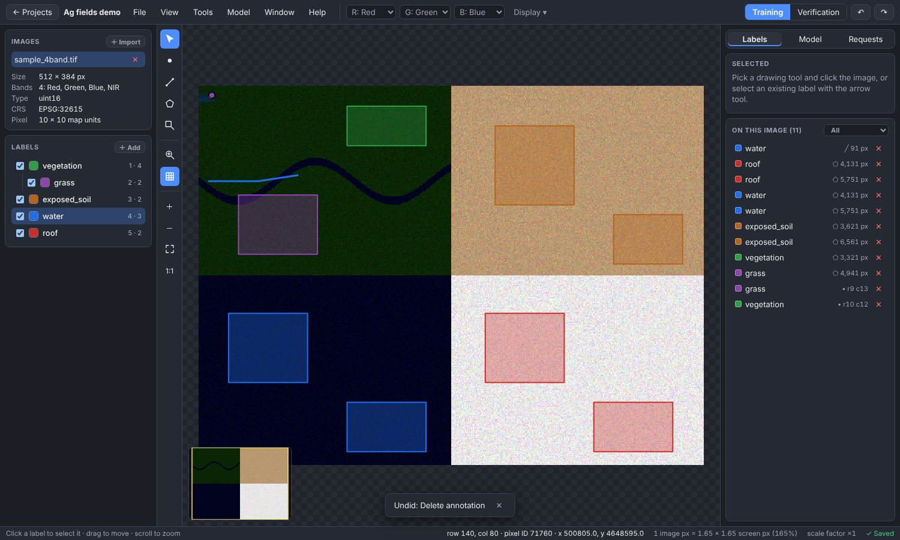

# Training Selection Tool

A web app for labeling satellite images. You open a GeoTIFF, create labels, and mark pixels with
points, lines and polygons. The labeled pixels are exported in the format agreed with the
**Model / Learning & Tools** and **Verification** groups. A simple built-in model and a
Verification mode are included so the whole loop can be tried end to end.

**Stack:** Flask + rasterio + scikit-learn (Python) backend, React frontend served by Flask.



## Start the app

You need **Python 3.10 or newer** (python.org; on Windows tick "Add Python to PATH").
Node.js is **not** needed to run the app.

| System | What to do |
|---|---|
| **Windows** | Double-click **`start.bat`** |
| **Mac / Linux** | In a terminal, inside this folder: **`./start.sh`** |

The first start installs the Python packages (a few minutes). After that it opens
**http://127.0.0.1:8000** in your browser. Keep the terminal window open while you use the app,
and press **Ctrl+C** in it to stop.

Doing it by hand instead of using the start script:

```bash
python -m venv .venv
source .venv/bin/activate            # Windows: .venv\Scripts\activate
pip install -r backend/requirements.txt
python run.py                        # options: --port 9000   --no-browser
```

### If something goes wrong

- **"Some Python packages are not installed"**: run the `pip install` line that the message shows.
- **rasterio fails to install**: run `python -m pip install --upgrade pip` and try again. If it
  still fails, your Python may be too new for a ready-made rasterio package; install Python 3.12.
- **The page does not open**: type `http://127.0.0.1:8000` into the browser yourself. If port 8000
  is taken, the app picks the next free one and prints the address in the terminal.
- **"Cannot reach the app server"** in the page: the terminal window was closed. Start the app again.

## Try it in five minutes

1. **Create project** on the first screen.
2. **Import a GeoTIFF**: choose `sample_data/sample_4band.tif` (512 × 384 px; Red, Green, Blue, NIR).
3. In **Labels**, click **＋ Add** and create `vegetation`, `exposed_soil`, `water`, `roof`.
   Hover a label and click **＋** to add a label inside it (for example `grass` inside `vegetation`).
4. Pick a label, pick the **polygon** tool (G) and click around an area; double-click to finish.
   Draw at least two shapes for each label. Points (P) and lines (L) work the same way.
5. Open the **Model** tab: **Train model**, then **Run v1 on …**. The prediction appears on the image.
6. Click **Suggest**. The model proposes labels (dashed diamonds). Press **N** to step through
   them and **A** / **R** / **U** to approve, reject or postpone. Only approved ones become training data.
7. Switch to **Verification** (top right). Click pixels to see the prediction, and use the flag
   tools to report a mistake. Back in **Training**, the report is in the **Requests** tab.
8. **File → Export training set** gives the JSON or CSV for the Model group.

**Pixel-accuracy check:** in the sample's top-left 16 × 16 pixels, the Blue band stores
`row*100 + col`. Label the pixel at row 3, col 4 and the details should show **B3 Blue = 304**.

## What it does

**Project screen**
- Create, open, rename, delete, search, export (.zip) and import projects. Each row shows a progress status.
- Everything is saved automatically after every change.

**Images**
- Import GeoTIFFs (.tif / .tiff); several per project. Size, bands, data type and CRS are shown.
- Unsupported or damaged files get a clear message.
- Choose which band is shown as R, G and B; true colour and false colour (NIR) presets.
- Brightness and contrast change the display only, never the data.

**Viewing**
- Scroll to zoom (pixels get bigger, no blurring), drag to move, Fit, 1:1.
- Zoom-to-region tool (Z): drag a box with the same shape as the window.
- Magnifier (M) that follows the cursor and outlines the exact pixel a click would label.
- Overview map, pixel grid, and a status bar with row/col, pixel ID, map coordinates and scale.
- Very large images are displayed at reduced size, but clicks and band values always use the original pixels.

**Labels**
- Label classes with labels inside them; add, rename, recolour, delete, promote and demote.
- Checkboxes show or hide labels; a class checkbox controls everything inside it.
- Label opacity slider.

**Labeling tools**
- Points, lines and polygons. Select, relabel, add a note, delete.
- Undo and redo (Ctrl+Z / Ctrl+Y) for drawing, deleting, relabeling and reviews.

**Label processing** (`backend/label_processing.py`)
- Lines and polygons are split into individual pixels.
- Only the labeled pixels' band values are read from the TIFF.
- A pixel labeled with two different classes is left out of the export and counted.
- Export as JSON (checked against `backend/schemas/`) or CSV for pandas.

**Model** (`backend/ml.py`, a stand-in for the Model group's engine)
- Random forest on the band values plus NDVI; trains on label classes or individual labels.
- Every training run is a new version; accuracy and a confusion matrix are shown for each.
- Refuses an image that lacks a band the model needs, and says which one.
- Prediction overlay with opacity, and model-suggested labels to approve, correct, reject or postpone.

**Verification**
- Compare the prediction with the image, inspect single pixels, focus on chosen classes.
- Flag a pixel or an area as wrong class / add points / remove points, with an explanation.
- Requests reach Training as `correction_request/1.0` records. Verification never edits labels.
- Mark an image as verified.

## Things to know

- The accuracy shown is measured on your own labeled pixels, not on independent data, so it is optimistic.
- Predicting is slow on very large images (every pixel is classified); the sample takes about a second.
- Exported project zips contain the images, labels and requests, but not trained models. Retrain after importing.
- There are no user accounts; the app is meant to run on your own computer.

## For developers

```bash
python -m pytest -q backend/tests        # 17 backend tests
python docs/examples/make_training_set_example.py   # regenerate the shared examples
```

Changing the frontend needs **Node.js 18+**:

```bash
cd frontend
npm install
npm run dev        # http://localhost:5173 with live reload; run `python run.py` in another terminal
npm run build      # rebuilds frontend/dist, which Flask serves. Commit the result.
```

```
run.py, start.bat, start.sh   one-command start
backend/app.py                Flask routes
backend/store.py              projects, label tree, annotations, undo / redo
backend/tiff_service.py       GeoTIFF info, display preview, exact pixel values
backend/label_processing.py   shapes to pixels, training-set export, schema checks
backend/ml.py                 train, predict, suggest
backend/verification.py       correction requests
backend/schemas/              JSON Schemas of the shared records
frontend/src/                 React app (ProjectScreen, Workspace, Viewer, LabelTree, Panels)
frontend/dist/                built site (committed)
sample_data/                  sample GeoTIFF + generator
docs/                         data exchange spec, flowcharts, platform decision, examples
experiments/                  Sprint 2 image-loading experiment
```

More: [`docs/data_exchange.md`](docs/data_exchange.md) ·
[`docs/flowcharts.md`](docs/flowcharts.md) · [`docs/platform_decision.md`](docs/platform_decision.md)

## Team

| | Discord |
|---|---|
| Ari | @a2d1t |
| Lumu | elummoum5104 |
| Suyash | thegodfather4392 |
