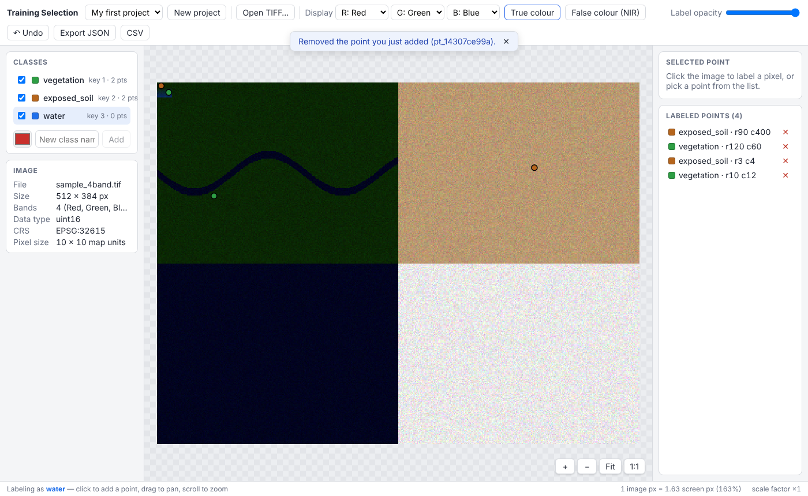

# Training Selection Tool

The Training Selection part of the satellite-image classification project. Users open a
GeoTIFF, create classes and label pixels. The labeled examples are exported in the format
agreed with the **Model / Learning & Tools** and **Verification** groups.

**Stack:** React (Vite) frontend · Flask + rasterio backend. The reasons are in
[`docs/platform_decision.md`](docs/platform_decision.md).



## What works (Sprint 2)

- **Open a GeoTIFF:** see its size, bands, data type, CRS and pixel size. Unsupported or broken files get a clear message.
- **Navigate:** fit to window, zoom with the scroll wheel or + / − (pixels get bigger, with no blurring), drag to pan, and a 1:1 view.
- **Choose display bands:** true colour, false colour (NIR), or any band on each R/G/B channel. This changes the display only.
- **Classes:** create a class with a name and colour, select it (keys 1–9), and show or hide it. Each class shows its point count.
- **Point labeling:** click a pixel to label it. The backend reads the **original** band values for that row/col.
- **Fix mistakes:** remove a point (✕ or the Delete key) and undo the last labeling action (Ctrl/Cmd + Z).
- **Export:** a JSON training set or a CSV for pandas (see [`docs/data_exchange.md`](docs/data_exchange.md)).
- **Correction requests from Verification:** accepted at `POST /api/projects/<pid>/correction-requests` and checked against the schema.

## Install

You need **Python 3.10+** and **Node.js 18+**.

```bash
git clone <repo-url> training-tool
cd training-tool

# backend
python -m venv .venv
source .venv/bin/activate          # Windows: .venv\Scripts\activate
pip install -r backend/requirements.txt

# frontend
cd frontend
npm install
cd ..
```

> **Windows and rasterio:** `pip install rasterio` installs a pre-built wheel on Python 3.10–3.13.
> If it fails, upgrade pip first with `python -m pip install --upgrade pip`, or use conda:
> `conda install -c conda-forge rasterio`.

## Run (development)

Use two terminals:

```bash
# terminal 1 – backend on http://localhost:5000
source .venv/bin/activate
python backend/app.py

# terminal 2 – frontend on http://localhost:5173 (forwards /api to Flask)
cd frontend
npm run dev
```

Then open **http://localhost:5173**, click **Open TIFF…** and choose `sample_data/sample_4band.tif`.

To run everything on one port instead, build the frontend with `cd frontend && npm run build`,
then run `python backend/app.py` and open http://localhost:5000.

## Sample data

`sample_data/sample_4band.tif` is the agreed test image: 512 × 384 px, bands Red, Green, Blue
and NIR (uint16), UTM 15N, 10 m pixels. It has four regions (vegetation, exposed soil, water,
roof). To regenerate it or make a bigger one:

```bash
python sample_data/make_sample_tiff.py                       # default
python sample_data/make_sample_tiff.py big.tif 4096 4096     # custom size
```

**Pixel-accuracy check:** in the top-left 16 × 16 block, the Blue band stores `row*100 + col`.
For example, if you click the pixel at row 3, col 4, the details panel should show **B3 Blue = 304**.

## Tests

```bash
python -m pytest -q backend/tests
```

The tests cover upload, the unsupported/corrupt file messages, exact pixel lookup
(including map coordinates), classes, adding and removing points, undo, export validity
and the shared example files.

## API

| Method | Path | Purpose |
|---|---|---|
| GET | `/api/health` | Health check |
| GET / POST | `/api/projects` | List / create projects |
| GET | `/api/projects/<pid>` | Project with images, classes, points |
| POST | `/api/projects/<pid>/images` | Upload a TIFF (multipart `file`) |
| GET | `/api/images/<iid>/preview.png?bands=1,2,3` | Display image (8-bit, display only) |
| GET | `/api/images/<iid>/pixel?row=&col=` | Original band values + map coordinates |
| POST | `/api/projects/<pid>/classes` | `{name, color?}` |
| POST | `/api/projects/<pid>/points` | `{image_id, class_id, row, col}` |
| DELETE | `/api/projects/<pid>/points/<point_id>` | Remove a point |
| POST | `/api/projects/<pid>/undo` | Undo the last add/remove |
| GET | `/api/projects/<pid>/images/<iid>/training-set[?format=csv&approved_only=1]` | Export |
| POST | `/api/projects/<pid>/correction-requests` | Receive feedback from Verification |

## Repository layout

```
backend/        Flask API, TIFF reading, project storage, JSON Schemas, tests
frontend/       React app (Vite)
sample_data/    sample GeoTIFF + generator
experiments/    Sprint 2 image-loading experiment (Python + geotiff.js) and RESULTS.md
docs/           platform decision, data exchange spec, flowcharts (+ PNGs), examples
```

## Team

| | Discord |
|---|---|
| Ari | @a2d1t |
| Lumu | elummoum5104 |
| Suyash | thegodfather4392 |

**Suggested split** (from the Sprint 2 plan): GUI frontend (`frontend/`), backend (`backend/app.py`,
`tiff_service.py`, `store.py`), and label processing / data exchange (`records.py`, `schemas/`, `docs/data_exchange.md`).
