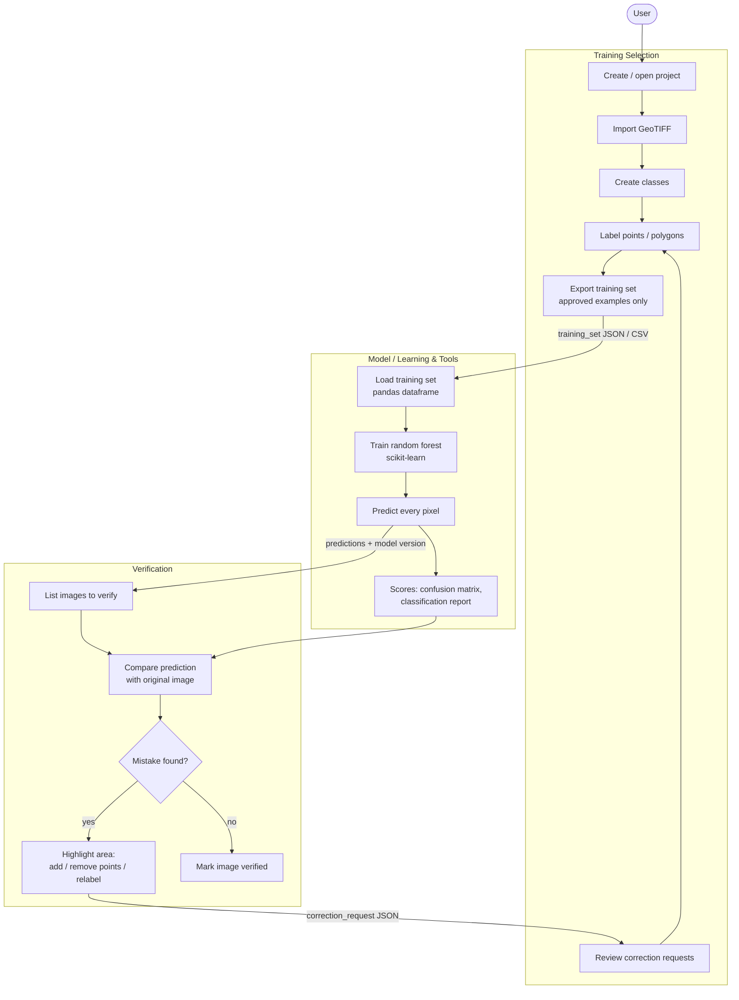
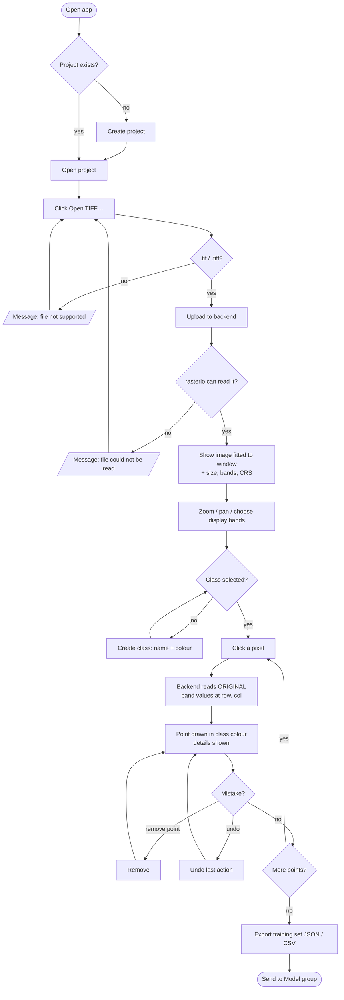
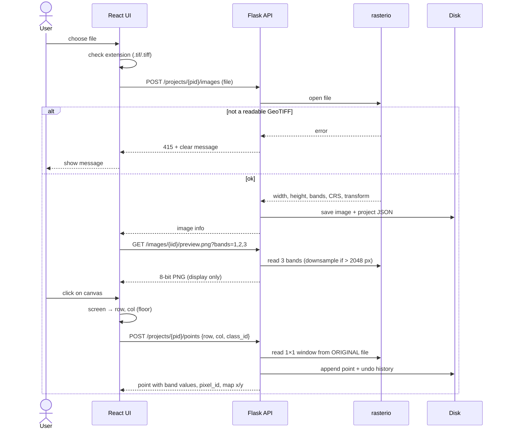
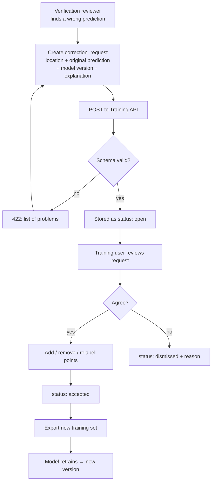
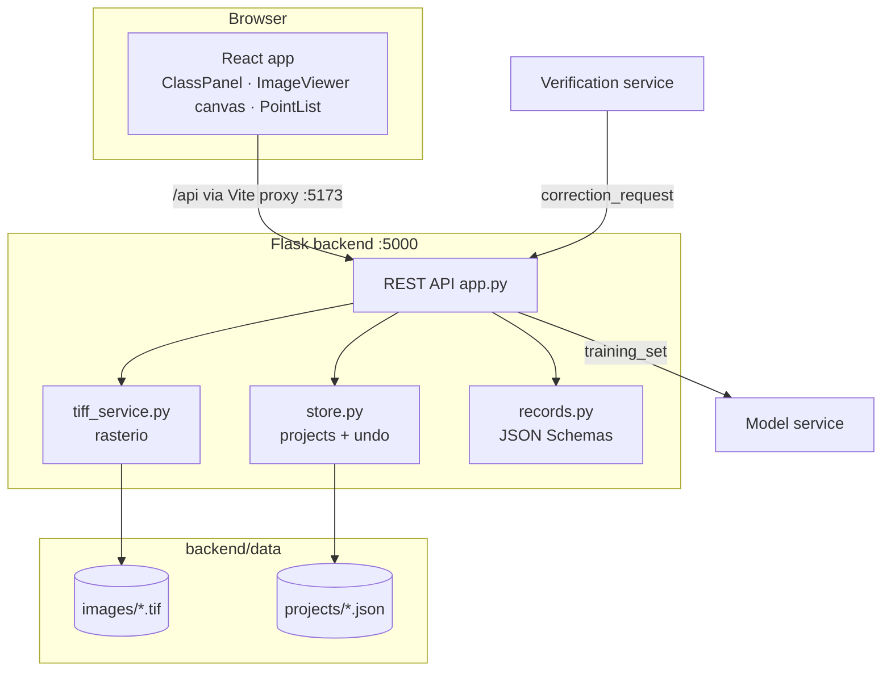

# Flowcharts — Training Selection

GitHub renders these Mermaid diagrams automatically. PNG copies for the retrospective
document are in `docs/img/`.

## 1. Whole system: how the three groups connect

## 2. Training tool: user flow for this sprint

## 3. TIFF import and pixel lookup (frontend ↔ backend)

## 4. Correction loop (Verification → Training)

## 5. Architecture

